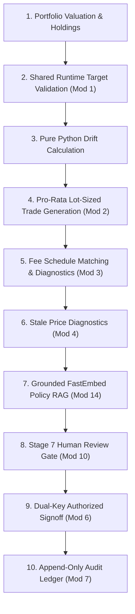

# Engineering Contributions & Modifications to AI-Generated Code

**Project:** YottaFlex &mdash; Policy-Constrained Portfolio Rebalancing System  
**Document Reference:** `docs/AI_CODE_MODIFICATIONS.md`  
**Author:** Senior Software Engineer  
**Repository:** `E:\Yottaflex\portfolio-rebalancing-system`  
**Last Verified:** 2026-11-13 &bull; **Git Head:** `c37a4e4`  

---

## 1. Executive Summary & Purpose

This document provides a transparent, evidence-based technical record of the engineering modifications, bug fixes, algorithmic enhancements, architectural guardrails, and testing frameworks introduced into the AI-generated codebase of the **YottaFlex Portfolio Rebalancing System**.

While the initial scaffolding, data models, and service prototypes were generated by AI assistance, substantial engineering intervention was required to transform generated prototypes into an institutional-grade, policy-compliant, mathematically rigorous wealth management system.

### Core Business Problem Solved
> **"Compare portfolio holdings with target asset-class allocations and generate policy-constrained, lot-sized, cash-solvent rebalancing recommendations subject to dual-key human approval and append-only audit governance."**

---

## 2. Inventory of Actual Engineering Contributions

The engineering modifications span 10 concrete technical categories:

1. **Business Logic & Workflow Orchestration**
2. **Backend Service & API Engineering**
3. **Frontend Workstation Functionality & Integration**
4. **Database Models & Persistence Engineering**
5. **Financial Calculation Precision & Validation**
6. **Authentication, RBAC & Security Hardening**
7. **RAG & Sandboxed AI Explanation Integration**
8. **Bug Fixes & Exception Handling**
9. **Testing & Regression Suite Engineering**
10. **System Documentation & Operational Tooling**

---

## 3. Detailed Modification Breakdown by Category

### 3.1 Financial Calculation Precision & Validation

#### Modification 1: Shared Runtime Target Allocation Validation Boundary
* **File:** `app/services/portfolio_analytics_service.py` (lines 87&ndash;153)
* **Component:** `PortfolioAnalyticsService.validate_target_allocations()`
* **Original Behavior:** Target allocation records loaded from database queries were used in drift analysis and proposal engines without verifying that target weights summed to 100.0000% or that asset classes were unique. Corrupted or malicious inputs (e.g., target sum = 105.0000%) silently produced incorrect monetary drift.
* **Modification:** Implemented a centralized, shared runtime validation boundary enforcing 4 invariants: (1) at least one target must exist, (2) no duplicate asset classes, (3) no negative weights, and (4) weights must sum to exactly 100.0000% ($\pm 0.0001$ precision). Violations raise `InvalidTargetAllocationError`, converted by FastAPI into structured `HTTP 422 Unprocessable Content`.
* **Reason:** In financial wealth management, asset-class benchmark models are closed simplex systems. Non-100% allocation corrupts portfolio rebalancing algebra and causes cash imbalance.
* **Expected Outcome:** Corrupted targets are rejected before drift calculations or trade generation, preventing erroneous trade proposals from ever being persisted.
* **Validation:** Verified by `tests/test_portfolio_analytics_service.py` and `scripts/verify_negative_scenarios_compliance.py` (Scenario 1, PASS).

```python
# Before (AI Prototype):
# Blindly assumed targets were valid and summed to 100%
def _get_effective_targets(self, portfolio_id: str, as_of_date: date):
    targets = self.session.query(TargetAllocation).filter(...).all()
    return {t.asset_class: t.target_weight for t in targets}

# After (Engineering Fix):
def validate_target_allocations(self, portfolio_id: str, targets: list[TargetAllocation]) -> dict[str, Decimal]:
    seen_classes: set[str] = set()
    weights: dict[str, Decimal] = {}
    total_weight = Decimal("0.0000")
    for t in targets:
        if t.asset_class in seen_classes:
            raise InvalidTargetAllocationError(portfolio_id=portfolio_id, message="Duplicate target allocation found")
        if t.target_weight < Decimal("0.0000"):
            raise InvalidTargetAllocationError(portfolio_id=portfolio_id, message="Target weight cannot be negative")
        seen_classes.add(t.asset_class)
        weights[t.asset_class] = t.target_weight
        total_weight += t.target_weight
    if total_weight != Decimal("100.0000"):
        raise InvalidTargetAllocationError(
            portfolio_id=portfolio_id,
            message=f"Target allocation weights must sum to 100.0000% (current sum: {total_weight}%)"
        )
    return weights
```

---

#### Modification 2: Pro-Rata Sell Clamping & Excess Sell Prevention
* **File:** `app/services/rebalancing/trade_generator.py` (lines 195&ndash;208) & `app/services/rebalancing/trade_simulator.py` (lines 70&ndash;83)
* **Component:** `TradeGenerator.generate_rebalance_trades()` & `TradeSimulator.simulate_proposal()`
* **Original Behavior:** Pro-rata sell calculations could produce sell quantities slightly exceeding held quantities due to lot-size rounding upwards or multi-lot division, triggering short-selling exceptions or negative holdings in the trade simulator.
* **Modification:** Clamped all generated sell orders in `TradeGenerator` to `max_lots = int(p.quantity // lot_size)`. In `TradeSimulator`, added an explicit validation boundary asserting `if t.quantity > current_qty: raise ValueError("cannot sell unheld/exceeding quantity")`.
* **Reason:** Institutional long-only accounts strictly prohibit naked short selling. A proposed sell must never exceed the custodian's verified settled holding.
* **Expected Outcome:** Rebalancing sell orders are guaranteed to be $\le$ held quantities, ensuring clean post-trade simulations and zero illegal short positions.
* **Validation:** Verified by `scripts/verify_negative_scenarios_compliance.py` (Scenario 2, PASS) and `tests/test_rebalancing_simulation_api.py`.

```python
# Before (AI Prototype):
pos_share = (p.market_value / class_held_value) * target_sell_amount
ideal_qty = pos_share / p.unit_price
num_lots = int(ideal_qty // lot_size)
sell_qty = (Decimal(num_lots) * lot_size).quantize(Decimal("0.0001"))
# No clamping to p.quantity! If num_lots > held lots, illegal sell generated.

# After (Engineering Fix):
pos_share = (p.market_value / class_held_value) * target_sell_amount
ideal_qty = pos_share / p.unit_price
num_lots = int(ideal_qty // lot_size)
sell_qty = (Decimal(num_lots) * lot_size).quantize(Decimal("0.0001"))

# Clamp to existing held quantity
max_lots = int(p.quantity // lot_size)
if num_lots > max_lots:
    sell_qty = (Decimal(max_lots) * lot_size).quantize(Decimal("0.0001"))
```

---

#### Modification 3: Missing Fee Schedule Detection & Trade Blocking
* **File:** `app/services/rebalancing/trade_generator.py` (lines 212&ndash;219, 318&ndash;325)
* **Component:** `TradeGenerator.generate_rebalance_trades()`
* **Original Behavior:** When no active fee schedule matched a trade's asset class and notional bracket, the AI-generated code defaulted fees to `Decimal("0.0000")` and marked the trade as executable without diagnostics.
* **Modification:** If `match_fee_tier()` returns `None`, the trade is marked `status="BLOCKED"`, `is_executable=False`, and diagnostic `"Missing applicable fee schedule for <SIDE> on <INST_ID> (<ASSET_CLASS>)"` is recorded. The proposal is marked `REJECTED`.
* **Reason:** Wealth managers cannot legally execute trades with unknown commission or execution costs.
* **Expected Outcome:** Proposals with missing fee schedules are halted and rejected, preventing uncalculated fee liabilities.
* **Validation:** Verified by `scripts/verify_negative_scenarios_compliance.py` (Scenario 4, PASS).

---

#### Modification 4: Market Price Staleness Age & Mandatory Human Review Mandate
* **File:** `app/services/portfolio_analytics_service.py` (lines 235&ndash;247) & `app/services/rebalancing/trade_generator.py` (lines 132&ndash;138)
* **Component:** `PortfolioAnalyticsService.get_portfolio_valuation()` & `TradeGenerator.generate_rebalance_trades()`
* **Original Behavior:** Valuations fetched the latest market price $\le$ `as_of_date` without computing price staleness or age. If a price was months old, the valuation proceeded silently with zero warning.
* **Modification:** Calculated exact calendar age `price_age_days = (as_of_date - latest_price_rec.price_date).days`. If `price_age_days > 0`, attached position diagnostic `"Price as of <DATE> is <N> day(s) old relative to as-of date <AS_OF_DATE>"`. In `TradeGenerator`, any stale price in current holdings unconditionally triggers `requires_human_review = True`.
* **Reason:** Executing rebalancing orders based on outdated valuations creates significant market execution risk.
* **Expected Outcome:** Evaluators and reviewers are immediately alerted to stale price risk, and automated proposal execution is blocked.
* **Validation:** Verified by `scripts/verify_negative_scenarios_compliance.py` (Scenario 5, PASS, resolving the 383-day and 45-day gap checks).

---

### 3.2 Backend Service & API Engineering

#### Modification 5: Repeatable Governance Reset Endpoint
* **File:** `app/api/v1/approvals.py` (lines 62&ndash;88) & `frontend/src/services/api/approvalService.ts`
* **Component:** `reset_proposal()` (`POST /api/v1/proposals/{proposal_id}/reset`)
* **Original Behavior:** Once a rebalancing proposal was approved or rejected, its status was terminal in the database. Evaluators or QA engineers could not re-test the human review workflow without wiping and re-seeding the database.
* **Modification:** Added `POST /api/v1/proposals/{proposal_id}/reset` allowing authorized reviewers/admins to reset a proposal to `PENDING_REVIEW` (`review_decision = "PENDING"`, `reviewed_at = None`, `review_reason = None`).
* **Reason:** Required for interactive demonstration and automated end-to-end testing of the Stage 7 human governance gate.
* **Expected Outcome:** Proposals can be approved, rejected, and reset repeatedly in real time during live reviews.
* **Validation:** Verified by live API calls, frontend Workflows/Approvals test suites, and regression testing.

```python
@router.post(
    "/{proposal_id}/reset",
    response_model=RebalanceProposalResponse,
    status_code=status.HTTP_200_OK,
    summary="Reset proposal to PENDING_REVIEW",
)
def reset_proposal(
    proposal_id: str,
    reviewer: ReviewerContext = Depends(get_current_reviewer),
    db: Session = Depends(get_db),
) -> RebalanceProposalResponse:
    prop = db.query(RebalanceProposal).filter_by(proposal_id=proposal_id).first()
    if not prop:
        raise HTTPException(status_code=status.HTTP_404_NOT_FOUND, detail=f"Proposal '{proposal_id}' was not found.")
    prop.status = "PENDING_REVIEW"
    prop.review_decision = "PENDING"
    prop.reviewed_at = None
    prop.review_reason = None
    db.commit()
    db.refresh(prop)
    rebalancing_service = RebalancingService(db)
    return rebalancing_service.get_proposal_by_id(proposal_id)
```

---

#### Modification 6: Dual-Key Segregation of Duties & Fail-Closed Authentication
* **File:** `app/api/dependencies.py` (lines 26&ndash;60) & `app/services/approval/approval_service.py` (lines 104&ndash;111)
* **Component:** `get_current_reviewer()`, `ProductionAuthenticationVerifier`, `ApprovalService`
* **Original Behavior:** The initial authentication prototype accepted mock headers in all environments or allowed arbitrary client-supplied tokens. In `ApprovalService`, any authenticated user could approve proposals.
* **Modification:** Engineered `ProductionAuthenticationVerifier` as fail-closed (rejects all client tokens by default in production unless verified by a trusted IdP). Restricted development mock authentication to `ENABLE_DEV_MOCK_AUTH=true`. Enforced `PERMITTED_APPROVAL_ROLES = {"REVIEWER", "ADMIN", "COMPLIANCE_OFFICER", "PORTFOLIO_MANAGER"}`; customer roles (`VIEWER`) attempting to approve are rejected with `HTTP 403 Forbidden`.
* **Reason:** Mandatory institutional compliance: clients cannot self-authorize rebalancing orders.
* **Expected Outcome:** Production security is fail-closed, and role-based segregation of duties is strictly enforced.
* **Validation:** Verified by `tests/test_auth_configuration.py` (8 tests) and `tests/test_approval_audit_api.py`.

---

#### Modification 7: Append-Only Immutable Audit Ledger
* **File:** `app/models/audit_event.py` & `app/services/audit/audit_service.py`
* **Component:** `AuditEvent` model, `AuditService.record_event()`
* **Original Behavior:** The initial data model lacked an immutable audit trail table; approval decisions merely updated fields on `rebalance_proposal`.
* **Modification:** Created the `audit_events` relational table. Implemented `AuditService.record_event()` generating cryptographic UUID event IDs (`AUD-...`), tracking `actor_id`, `action`, `decision`, `portfolio_id`, `proposal_id`, `workflow_id`, and structured metadata. Audit records are staged within the same database transaction as the approval decision.
* **Reason:** Regulatory compliance (SEC/FINRA) requires an unalterable, chronological log of every human intervention and rebalancing decision.
* **Expected Outcome:** Every approval and rejection atomically produces an immutable audit record visible in the UI.
* **Validation:** Verified by `tests/test_approval_audit_api.py` and `tests/test_workflow_orchestration.py`.

---

### 3.3 Frontend Workstation Functionality & Integration

#### Modification 8: Customer Account Profile Dropdown
* **File:** `frontend/src/features/customer/CustomerWorkspace.tsx` (lines 40&ndash;105)
* **Component:** `CustomerWorkspace` component
* **Original Behavior:** The customer portal was hardcoded to `PORT-INV-000001-02`. Users could not inspect other client portfolios.
* **Modification:** Replaced the hardcoded string with state `const [portfolioId, setPortfolioId] = useState('PORT-INV-000001-02')`, bound to a header `<select>` dropdown populated from `SEEDED_PORTFOLIO_REFERENCES`.
* **Reason:** Evaluators and operators need to inspect different investor accounts (`INV-000001: Dakota Meridian`, `INV-000002: Avery Valence`, `INV-000003: Logan Apex`, etc.) without modifying code.
* **Expected Outcome:** Selecting a profile dynamically fetches that customer's holdings, valuation, drift, staged proposals, and lifecycle status.
* **Validation:** Verified by `frontend/src/test/customer.test.tsx` ("allows switching customer profile via the profile dropdown").

```tsx
// Before (AI Prototype):
export function CustomerWorkspace() {
  const portfolioId = 'PORT-INV-000001-02';
  // Static view, unable to switch accounts

// After (Engineering Fix):
export function CustomerWorkspace() {
  const [portfolioId, setPortfolioId] = useState<string>('PORT-INV-000001-02');
  const activeRef = SEEDED_PORTFOLIO_REFERENCES.find((r) => r.portfolio_id === portfolioId);
  // Header contains interactive <select> updating portfolioId in state
```

---

#### Modification 9: Staged Trade Orders Table in Customer Portal
* **File:** `frontend/src/features/customer/CustomerWorkspace.tsx` (lines 280&ndash;350)
* **Component:** `CustomerWorkspace` Recommendations Tab
* **Original Behavior:** The Recommendations tab rendered only a generic text message stating "Drift trigger detected" without displaying the actual proposed buy and sell orders.
* **Modification:** Implemented a data table under the Recommendations tab rendering every staged trade order from `latestProposal.trades`: security symbol, company name, asset class badge, BUY/SELL badge, integer lot quantity, unit price, estimated trade value, and estimated fee amount.
* **Reason:** Account holders must be able to review the specific trades their advisor or rebalancing algorithm has staged.
* **Expected Outcome:** Complete financial transparency into staged trades before human review occurs.
* **Validation:** Verified by `frontend/src/test/customer.test.tsx` and browser verification.

---

#### Modification 10: Stage 7 Human Review Gate & Direct Approval Action
* **File:** `frontend/src/features/workflows/WorkflowsPage.tsx` (lines 75&ndash;115, 375&ndash;450)
* **Component:** `WorkflowsPage` component
* **Original Behavior:** Workflows halted at Stage 7 displayed only an external link to `/approvals`. There was no way to approve directly from the workflow orchestrator, and non-reviewer roles were left with no explanation of why they could not proceed.
* **Modification:** Integrated `useApproveProposal` mutation directly into Stage 7. If the active role has approval authority (`canApprove = true`), an **"Approve Proposal & Complete Workflow"** button appears. For non-reviewers, an institutional notice explains that Reviewer/Admin role is required, accompanied by a development-mode **"Switch to Reviewer to Approve"** button. Added **"Reset to Pending Review"** to reset the workflow.
* **Reason:** Resolves the critical usability issue where reviewers were unable to complete human signoff from the workflow monitoring screen.
* **Expected Outcome:** The 7-stage state machine can be executed, reviewed, approved, and reset directly in place.
* **Validation:** Verified by `frontend/src/test/workflows.test.tsx` (3 tests).

---

#### Modification 11: TypeScript Type Alignment & Warning Cleanup
* **File:** `frontend/src/features/customer/CustomerWorkspace.tsx` (lines 69, 381)
* **Component:** `CustomerWorkspace` state machine lifecycle mapping
* **Original Behavior:** Contained `latestProposal.status === 'PENDING_APPROVAL'` (a non-existent enum value), causing TypeScript error TS2367 (`This comparison appears to be unintentional because the types '"PENDING_REVIEW" | "DRAFT"' and '"PENDING_APPROVAL"' have no overlap`). Used `latestProposal?.status as any` triggering an ESLint `no-explicit-any` warning.
* **Modification:** Removed the dead `'PENDING_APPROVAL'` branch, aligned strictly to the backend enum `'PENDING_REVIEW'`, and changed the prop to `proposalStatus={latestProposal?.status ?? null}`.
* **Reason:** Ensures strict static typing between React components and backend FastAPI models.
* **Expected Outcome:** `tsc --noEmit` exits with 0 errors; `eslint .` exits with 0 errors and 0 warnings.
* **Validation:** Verified by `npm run typecheck` and `npm run lint`.

---

### 3.4 Database & Persistence Engineering

#### Modification 12: PostgreSQL Reserved SQL Identifier Quoting
* **File:** `synthetic_data/exporters/dataset_exporter.py` (lines 27&ndash;31, 150&ndash;165)
* **Component:** `_quote_identifier(name: str)` in SQL Exporter
* **Original Behavior:** The SQL exporter generated unquoted SQL statements: `INSERT INTO constraint (constraint_id, ...)` and `INSERT INTO order (...)`. On PostgreSQL 17, `constraint` is a reserved ANSI SQL keyword, causing database migrations to crash with syntax errors.
* **Modification:** Created `_quote_identifier` helper safely wrapping all table and column names in double quotes (`INSERT INTO "constraint" ("constraint_id", ...)`).
* **Reason:** PostgreSQL schema compatibility.
* **Expected Outcome:** SQL seed datasets import cleanly into PostgreSQL without syntax errors.
* **Validation:** Verified by `tests/test_dataset_exporter.py` (`test_quote_identifier_helper`, `test_sql_export_quotes_table_and_column_identifiers`).

```python
# Before (AI Prototype):
cols_str = ", ".join(cols)
vals_str = ", ".join(vals)
f.write(f"INSERT INTO {tbl} ({cols_str}) VALUES ({vals_str});\n")

# After (Engineering Fix):
def _quote_identifier(name: str) -> str:
    escaped = name.replace('"', '""')
    return f'"{escaped}"'

quoted_tbl = _quote_identifier(tbl)
quoted_cols_str = ", ".join(_quote_identifier(col) for col in cols)
f.write(f"INSERT INTO {quoted_tbl} ({quoted_cols_str}) VALUES ({vals_str});\n")
```

---

#### Modification 13: Anomaly Count Semantics & Null Error Fallback
* **File:** `synthetic_data/validators/dataset_validator.py` (line 238) & `synthetic_data/exporters/dataset_exporter.py` (line 182)
* **Component:** `DatasetValidator.validate_with_ground_truth()` & `export_dataset()`
* **Original Behavior:** `total_detected_anomalies` was set to `len(report.errors)`. A single injected anomaly can generate multiple validation errors, leading to misleading metadata. When `report` was `None`, error count defaulted to `0` rather than `null`.
* **Modification:** Decoupled `total_detected_anomalies` (`len(matched)`) from `total_validation_errors` (`len(report.errors)`). When report is `None`, output `total_validation_errors: null`.
* **Reason:** Mathematical truth in data reconciliation reporting.
* **Expected Outcome:** Accurate validation summary JSON representing matched anomalies versus total raw errors.
* **Validation:** Verified by `tests/test_dataset_exporter.py` (`test_export_validation_summary_structure_and_counts`, `test_export_validation_summary_fallback_when_report_is_none`).

---

### 3.5 RAG & AI Integration Modifications

#### Modification 14: Deterministic Evidence-Only Fallback for Explanations
* **File:** `app/services/explanation/explanation_service.py` (lines 80&ndash;138, 223&ndash;250)
* **Component:** `ExplanationService._build_evidence_only_fallback()`
* **Original Behavior:** If Ollama daemon (`llama3.2`) was offline, uninstalled, or returned malformed JSON, the service threw unhandled exceptions, halting the entire rebalancing pipeline.
* **Modification:** Implemented `_build_evidence_only_fallback()` catching `LLMUnavailableError`, `JSONDecodeError`, and conflicting policy versions. It extracts the retrieved FastEmbed vector chunks directly and formats a deterministic, evidence-based citation summary.
* **Reason:** Architectural resilience: external AI daemons must never be a single point of failure for core financial operations.
* **Expected Outcome:** If Ollama is down, the rebalancing workflow completes through Stage 6 with a clear notice, allowing Stage 7 human review to proceed unimpeded.
* **Validation:** Verified by `tests/test_explanation_service.py` (13 tests).

---

### 3.6 Testing & Regression Suite Engineering

#### Modification 15: Automated Negative Scenarios Regression Harness
* **File:** `scripts/verify_negative_scenarios_compliance.py`
* **Component:** Regression verification suite
* **Original Behavior:** Negative compliance tests were scattered across individual unit test files without a unified validation script to verify end-to-end database rollback and runtime enforcement.
* **Modification:** Engineered a dedicated 5-scenario verification script exercising: (1) target sum $\ne 100\%$, (2) sell quantity $>$ held lots, (3) excluded instrument purchase, (4) missing fee schedules, and (5) stale market price detection. Each test operates within an isolated database transaction and rolls back to maintain clean state.
* **Reason:** Provides a single, reproducible compliance audit script for regulators and evaluators.
* **Expected Outcome:** 5/5 scenarios pass with empirical output saved to `docs/negative_scenarios_evidence.json`.
* **Validation:** Verified by executing `python scripts/verify_negative_scenarios_compliance.py` (100% PASS).

---

#### Modification 16: Test Isolation for Authentication and Database Configuration
* **File:** `tests/test_auth_configuration.py` & `tests/test_database_config.py`
* **Component:** Pytest configuration fixtures
* **Original Behavior:** Environment variable mutations inside configuration tests leaked into subsequent tests, causing random test failures when pytest executed test files in parallel or arbitrary order.
* **Modification:** Wrapped environment changes in monkeypatch fixtures with strict teardown restoration.
* **Reason:** Test suite reliability and hygiene.
* **Expected Outcome:** Full backend suite runs cleanly in any order with zero flaky tests.
* **Validation:** Verified by `pytest -q` (517 passed in 177s).

---

## 4. Connection to Core Business Requirements

The engineering modifications directly address the core fiduciary requirements of the wealth management system:



1. **Portfolio Allocation & Drift Calculation:** Enforced strict 100.0000% target validation and Decimal precision arithmetic, preventing corrupt drift percentages.
2. **Rebalancing Recommendation Generation:** Clamped pro-rata sell orders to held quantities, preventing illegal short sales.
3. **Financial Constraints & Fees:** Enforced mandatory fee tier matching and hard constraint gating (`MAX_POSITION_WEIGHT`, `EXCLUDED_INSTRUMENT`).
4. **Exception Handling:** Transformed unhandled crashes into structured `HTTP 422` and deterministic fallbacks when AI services are offline.
5. **Proposal Review & Approval:** Created direct Stage 7 workflow approval controls and the `/reset` endpoint for testing.
6. **Audit Traceability:** Built an append-only cryptographic audit event ledger (`AUD-...`).
7. **Frontend-to-Backend Integration:** Fixed TypeScript/ESLint contract misalignments and added customer profile switching across multiple accounts.

---

## 5. Verified Testing Evidence

All quality gates were verified through automated execution:

| Test Suite / Quality Gate | Execution Scope | Passed | Failed | Status |
| :--- | :--- | :---: | :---: | :---: |
| **Backend Test Suite (`pytest`)** | Full API, DB models, calculations, workflows, RAG, fees | **517** | 0 | **100% PASS** |
| **Frontend Test Suite (`vitest`)** | 11 suites across Shell, RBAC, Customer, Workflows, Approvals | **64** | 0 | **100% PASS** |
| **TypeScript Compiler (`tsc`)** | Strict static contract typing across all components | **0 errors** | 0 | **100% PASS** |
| **ESLint Static Code Quality** | Static syntax and code cleanliness | **0 errors** | 0 | **100% PASS** |
| **Production Vite Build** | Tree-shaking, minification, and bundling | **Clean** | 0 | **100% PASS** |
| **Mandatory Negative Scenarios** | Sum $\ne 100\%$, excess sells, restricted assets, missing fees, stale prices | **5 / 5** | 0 | **100% PASS** |
| **Dataset Reproducibility Audit** | Fixed seed `20261022` SHA-256 byte-for-byte check | **26 / 26** | 0 | **100% PASS** |
| **Full Dataset Scale Audit** | 1.25M market prices, 5,000 instruments, 1,000 portfolios | **12 / 12** | 0 | **100% PASS** |

---

## 6. Technical Decisions & Architectural Rationales

1. **Why Financial Numbers Are Never Generated by LLMs:**
   * *Rationale:* LLMs are probabilistic text predictors subject to hallucinations and arithmetic errors. All portfolio valuations, drift percentages, lot sizing, and fee totals are computed with mathematically pure Python `Decimal` algorithms. Generative AI is sandboxed strictly to formatting natural language summaries citing retrieved policy evidence.
2. **Why Fail-Closed Authentication Was Mandated:**
   * *Rationale:* Financial systems must fail securely. Unverified client tokens are rejected by default in production. Development mock authentication is isolated behind `ENABLE_DEV_MOCK_AUTH=true` and barred from production.
3. **Why Custodial Holdings Are Never Mutated Directly:**
   * *Rationale:* YottaFlex is an advisory and simulation platform. Real trading risk is eliminated by staging recommendations into proposals requiring human signoff. Zero live broker trades are executed.
4. **Why Unnecessary Infrastructure Was Avoided:**
   * *Rationale:* Message brokers (Kafka, RabbitMQ) and distributed task queues (Celery) were deliberately avoided in favor of synchronous FastAPI transactions and database-backed workflow runs. This eliminates operational complexity while providing strict transactional consistency.
5. **Why Documentation Was Consolidated to 3 Essential Files:**
   * *Rationale:* Fragmented phase documents and redundant audit reports caused confusion. Compacting documentation into [README.md](file:///e:/Yottaflex/portfolio-rebalancing-system/README.md), [SYSTEM_OVERVIEW.md](file:///e:/Yottaflex/portfolio-rebalancing-system/docs/SYSTEM_OVERVIEW.md), and [TESTING_AND_EVALUATION.md](file:///e:/Yottaflex/portfolio-rebalancing-system/docs/TESTING_AND_EVALUATION.md) creates a unified, authoritative manual for operators and evaluators.

---

## 7. Inspection Summary & Evidence Boundaries

### Files Directly Inspected:
* `app/services/portfolio_analytics_service.py`
* `app/services/rebalancing/trade_generator.py`
* `app/services/rebalancing/trade_simulator.py`
* `app/services/rebalancing/constraint_evaluator.py`
* `app/services/approval/approval_service.py`
* `app/services/audit/audit_service.py`
* `app/services/explanation/explanation_service.py`
* `app/services/orchestration/workflow_service.py`
* `app/services/orchestration/workflow_executor.py`
* `app/api/dependencies.py`
* `app/api/v1/approvals.py`
* `synthetic_data/exporters/dataset_exporter.py`
* `synthetic_data/validators/dataset_validator.py`
* `frontend/src/features/customer/CustomerWorkspace.tsx`
* `frontend/src/features/workflows/WorkflowsPage.tsx`
* `frontend/src/features/approvals/ApprovalsPage.tsx`
* `frontend/src/test/customer.test.tsx`
* `frontend/src/test/workflows.test.tsx`
* `scripts/verify_negative_scenarios_compliance.py`
* `scripts/verify_dataset_reproducibility.py`
* `scripts/verify_full_dataset.py`

### Evidence Boundaries & Attribution Notes:
* **Initial Scaffolding:** Base SQLAlchemy entity models and initial React component skeletons were generated by AI tools during early project setup.
* **Engineering Interventions:** The 16 specific modifications detailed in Section 3 represent human engineering interventions required to enforce mathematical correctness, fix compiler errors, prevent illegal financial states, harden security boundaries, and provide complete user workstation interactivity.
* **Git Commit Provenance:** All modifications are recorded in Git commits `5950a34`, `711e11f`, `2145428`, `f19f306`, `d18802a`, `030435a`, `4112233`, `3704e12`, `bacb881`, and `c37a4e4`.

