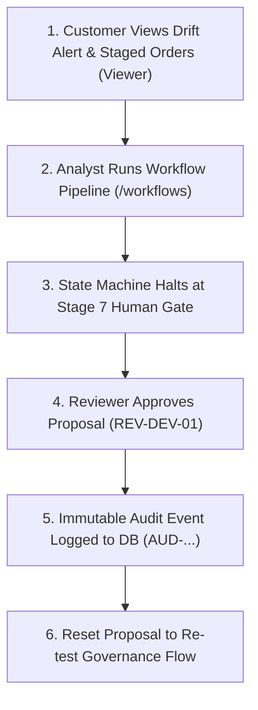

# System Overview & User Guide

**Document Reference:** `docs/SYSTEM_OVERVIEW.md`
**Application Port:** `5173` (Frontend) • `8000` (FastAPI) • `5433` (PostgreSQL) • `11434` (Ollama)

---

## 1. Architecture & Separation of Concerns

YottaFlex is an institutional-grade portfolio rebalancing system. It continuously compares investor holdings against benchmark asset-class allocations, calculates corridor drift, evaluates hard/soft constraints, generates lot-sized trade proposals, and enforces dual-key human governance.

```text
                                  +---------------------------------------------------+
                                  |        React 18 + Vite Frontend (Port 5173)       |
                                  |   [Customer]   [Analyst]   [Compliance]   [Admin] |
                                  +---------------------------------------------------+
                                                            |  REST API / Auth Headers
                                                            v
                                  +---------------------------------------------------+
                                  |            FastAPI Backend (Port 8000)            |
                                  +---------------------------------------------------+
                                                            |
                                            +---------------+---------------+
                                            |                               |
                              +---------------------------+   +---------------------------+
                              |   Workflow Orchestration  |   |    Approval Governance    |
                              |      (WorkflowService)    |   |     (ApprovalService)     |
                              +---------------------------+   +---------------------------+
                                            |                               |
                  +-------------------------+-------------------------+     |
                  |                         |                         |     |
    +---------------------------+ +-------------------+ +-----------------+ |
    | PortfolioAnalyticsService | | TradeGenerator &  | | PolicyRAGService| |
    | (Valuation & Drift Core)  | | Simulator Engine  | |(Ollama llama3.2)| |
    +---------------------------+ +-------------------+ +-----------------+ |
                  |                         |                         |     |
                  +-------------------------+-------------------------+     |
                                            |                               |
                              +---------------------------+   +---------------------------+
                              | PostgreSQL 17 Database    |   | Immutable Audit Ledger    |
                              | (16 Relational Tables)    |   |      (audit_events)       |
                              +---------------------------+   +---------------------------+
```

### Inviolable Invariants:
1. **Mathematical Determinism:** Valuations, drift calculations, lot-sizing, cash solvency, and tiered fee schedules are computed with exact Python `Decimal` arithmetic. **Financial numbers are never generated by LLMs.**
2. **Grounded Policy Retrieval (FastEmbed ONNX):** Investment mandates and fiduciary policies are vectorized via `BAAI/bge-small-en-v1.5` and retrieved using cosine similarity.
3. **Sandboxed Generative Explanations (Ollama `llama3.2`):** Generative AI formats natural language summaries citing retrieved policy evidence. If Ollama is offline, a deterministic fallback ensures continuous operation.
4. **Mandatory Human-in-the-Loop Governance:** All trades are staged in proposals requiring verified human approval (`REVIEWER` or `ADMIN`). **Custodial holdings are never mutated directly; zero live broker trades are executed.**
5. **Shared Runtime Target Allocation Validation:** Target allocations must sum to exactly 100.0000% at runtime; invalid sums are rejected with structured `HTTP 422`.

---

## 2. The 7-Stage State Machine Transition Pipeline

Workflow runs (`/workflows`) coordinate rebalancing through an agentic state machine with strict idempotency protection:

| Stage | Name | Stage Key | Description |
| :---: | :--- | :--- | :--- |
| **01** | **Received** | `RECEIVED` | Request validated; idempotency key hashed to prevent duplicate executions. |
| **02** | **Validating** | `VALIDATING` | Target allocation weights verified to sum to exactly 100.0000%. |
| **03** | **Drift Analysis** | `DRIFT_ANALYSIS` | Corridor threshold bands ($\pm 5\%$) evaluated across all asset classes. |
| **04** | **Proposal & Fees** | `PROPOSAL_GENERATION` | Integer lot sizing, tiered fee deductions, and cash solvency verified. |
| **05** | **FastEmbed RAG** | `RETRIEVING_POLICIES` | Compliance policies embedded and vector-matched via cosine similarity. |
| **06** | **Grounded Summary** | `GENERATING_EXPLANATION`| Ollama or deterministic fallback prepares evidence-grounded summary. |
| **07** | **Human Review** | `PENDING_HUMAN_REVIEW` | **HALTED AT REVIEW GATE.** Institutional signoff required to proceed. |

---

## 3. Workstations & User Guide

### 4 Institutional RBAC Personas (Top-Right Menu)

* **`REV-DEV-VIEWER` (Customer / Account Holder):** Read-only view of their personal wealth portfolio. Cannot self-approve proposals or generate trades (`HTTP 403 Forbidden`).
* **`REV-DEV-ANALYST` (Operations Analyst):** Can analyze drift, initiate workflows, and stage proposals. Cannot self-approve proposals (separation of duties).
* **`REV-DEV-01` (Risk & Compliance Reviewer):** Authorized to execute mandatory human-in-the-loop signoff/rejection.
* **`REV-DEV-ADMIN` (System Administrator):** Master reference data, system diagnostics, and audit trail oversight.

### Customer Account Profiles (Profile Switcher)
Inside the Customer Portal, use the **Customer Profile Dropdown** in the header to switch between individual client accounts (`INV-000001: Dakota Meridian`, `INV-000002: Avery Valence`, `INV-000003: Logan Apex`, etc.).

### Workstation Navigation:
1. **Customer Account Portal (`/customer`):**
   * **Overview:** Portfolio valuation, cash balance, asset class allocation charts.
   * **My Portfolio:** Holdings table with security details, prices, and staleness age indicators.
   * **Recommendations:** Drift trigger banner + **Staged Trade Orders Table** showing symbols, lots, prices, notional values, and fees.
   * **Activity:** 8-stage **Central Rebalancing Lifecycle** stepper and immutable audit trail.
2. **Workflow Orchestration (`/workflows`):**
   * Interactive **Initiate Workflow** trigger for any target portfolio.
   * 7-stage state transition pipeline visualizer with live stage status.
   * Stage 7 gating bar: Reviewers see **Approve Proposal & Complete Workflow**; Viewers see clear institutional guidance with a quick role switcher.
   * **Reset to Pending Review** action to re-test the human gate repeatedly.
3. **Approvals & Governance Desk (`/approvals`):**
   * Proposal selector dropdown (`RB-2026-000001` through `RB-2026-000023`).
   * Pre-trade vs post-trade simulation metrics and fee breakdown.
   * Hard constraint violation detection (`CLEARED FOR APPROVAL` vs `BLOCKED BY CONSTRAINTS`).
   * **Approve Proposal** with optional notes; **Reject Proposal** with mandatory justification.
   * **Reset to Pending Review** endpoint (`POST /api/v1/proposals/{id}/reset`).
4. **Portfolio Analytics Desk (`/portfolios`):**
   * Deep-dive portfolio surveillance, holdings search, and corridor tolerance band tracking.

### End-to-End Guided Evaluator Walkthrough



1. **Experience the Customer View:**
   * Select **`REV-DEV-VIEWER`** from the top-right persona dropdown.
   * Navigate to **Customer Portal** (`/customer`).
   * Review portfolio valuation ($436,718.28) and drift warning.
   * Click **Recommendations** tab to view all 5 staged rebalancing orders.
   * Click **Activity** tab to see Stage 3 (Drift Calculation) in the lifecycle stepper.
2. **Initiate Workflow as an Analyst:**
   * Switch to **`REV-DEV-ANALYST`** from the top-right dropdown.
   * Navigate to **Workflows** (`/workflows`).
   * Click **`Initiate Workflow`**.
   * Observe Stages 1–6 turning green, and Stage 7 halting with amber badge: **`HALTED AT REVIEW GATE`**.
3. **Authorize Proposal as Reviewer:**
   * Switch to **`REV-DEV-01`** (Risk Reviewer).
   * On the **Workflows** page, observe the active button: **`Approve Proposal & Complete Workflow`**.
   * Click it! The badge immediately updates to **`PIPELINE COMPLETED`**.
   * Navigate to **Approvals Desk** (`/approvals`): observe that `RB-2026-000002` is now `APPROVED`.
4. **Verify the Immutable Audit Trail:**
   * Scroll down to the **Audit Trail** card on the Approvals Desk or in the Customer Portal.
   * Observe the newly created record: Action `APPROVE`, Reviewer `REV-DEV-01`, Event ID `AUD-...`, exact ISO-8601 UTC timestamp.
5. **Test Proposal Reset:**
   * On the Approvals Desk or Workflows page, click **`Reset to Pending Review`**.
   * The proposal instantly reverts to `PENDING_REVIEW`, clearing the way for subsequent tests or rejections.

---

## 4. Core Relational Data Model

The PostgreSQL database maintains 16 core relational entities:

* **Identity & Accounts:** `investor_profile`, `portfolio`.
* **Securities & Pricing:** `instrument`, `holding`, `market_price`.
* **Mandates & Fees:** `target_allocation`, `fee_schedule`, `constraint`, `constraint_instrument`.
* **Proposals & Execution:** `rebalance_proposal`, `trade`.
* **Knowledge & Vectors:** `policy_documents`, `policy_chunks`.
* **Governance & Audit:** `workflow_runs`, `audit_events`.

---

## 5. Main API Routes Matrix

| Capability | HTTP Method & Route | Authorized Roles | Description |
| :--- | :--- | :--- | :--- |
| **Health** | `GET /health` | Public | System status and service reachability. |
| **Valuation** | `GET /api/v1/portfolios/{id}/valuation` | All | Point-in-time portfolio market value and holdings. |
| **Drift** | `GET /api/v1/portfolios/{id}/drift` | All | Corridor drift calculation against target allocations. |
| **List Proposals** | `GET /api/v1/proposals` | All | Filterable list of rebalancing proposals. |
| **Get Proposal** | `GET /api/v1/proposals/{id}` | All | Staged trades, simulation, fees, and constraints. |
| **Approve Proposal**| `POST /api/v1/proposals/{id}/approve` | Reviewer, Admin | Fiduciary approval; records immutable audit event. |
| **Reject Proposal** | `POST /api/v1/proposals/{id}/reject` | Reviewer, Admin | Rejection with mandatory reason; records audit event. |
| **Reset Proposal** | `POST /api/v1/proposals/{id}/reset` | Reviewer, Admin | Resets proposal to `PENDING_REVIEW` for re-testing. |
| **Audit Trail** | `GET /api/v1/proposals/{id}/audit` | All | Chronological append-only audit event history. |
| **Run Workflow** | `POST /api/v1/workflows/rebalance` | Analyst, Admin | Initiates idempotent 7-stage state machine run. |
| **Policy Inquire** | `POST /api/v1/policies/ask` | All | Grounded compliance question answering with citations. |

---

## 6. Evaluator FAQ

* **Why was proposal RB-2026-000002 showing 0 audit events initially?**
  Audit events are append-only cryptographic records generated when a human governance decision is rendered (`POST /approve` or `POST /reject`). Seed proposals wait in `PENDING_REVIEW` until acted upon. As soon as an action occurs, an `AUD-...` event is recorded.
* **Why are there 4 users in the menu when there are many investors?**
  The top-right menu is a **Security Role (RBAC) Switcher** for the 4 institutional system personas (`VIEWER`, `PORTFOLIO_MANAGER`, `REVIEWER`, `ADMIN`). To switch between individual client wealth accounts, use the **Customer Profile Dropdown** inside the Customer Portal.
* **What happens when an order breaches a Hard Constraint?**
  Hard constraints (e.g., `MAX_POSITION_WEIGHT = 25%` or `EXCLUDED_INSTRUMENT`) strictly block execution. In `RebalancingService`, the violating trade is marked `BLOCKED`, the proposal is marked `REJECTED`, and the Approvals Desk disables the Approve button, displaying a red alert detailing the breach.
* **What happens if Ollama is offline?**
  The Policy RAG service automatically activates an offline fallback that delivers deterministic evidence-based citations and summaries directly from the FastEmbed vector store without crashing.
