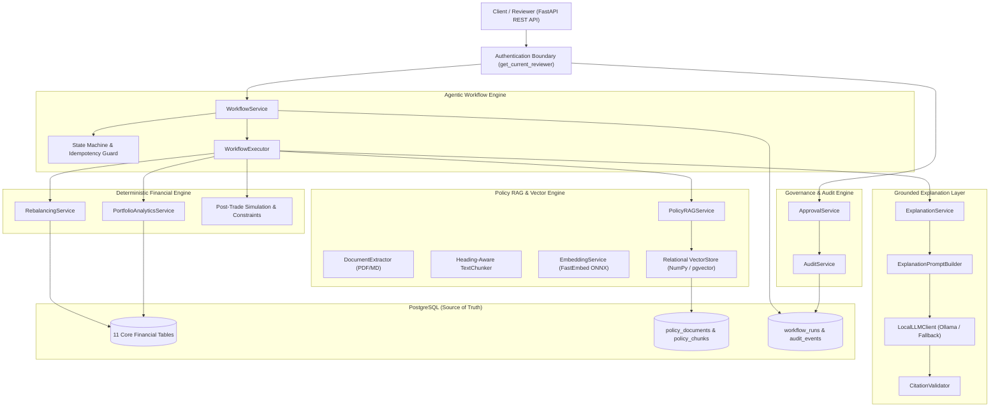
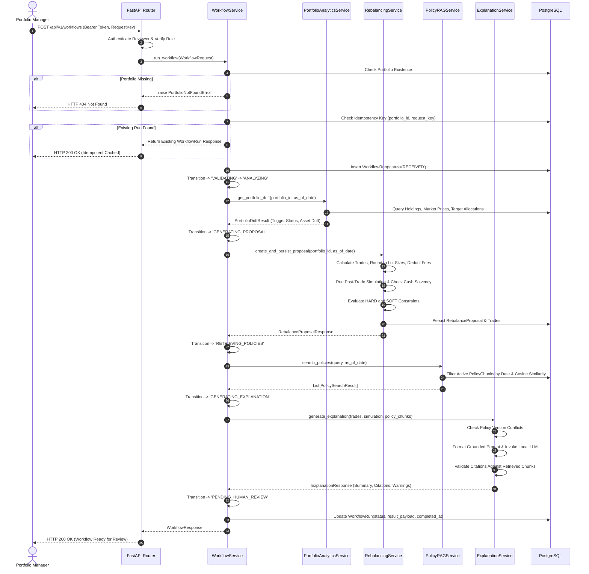
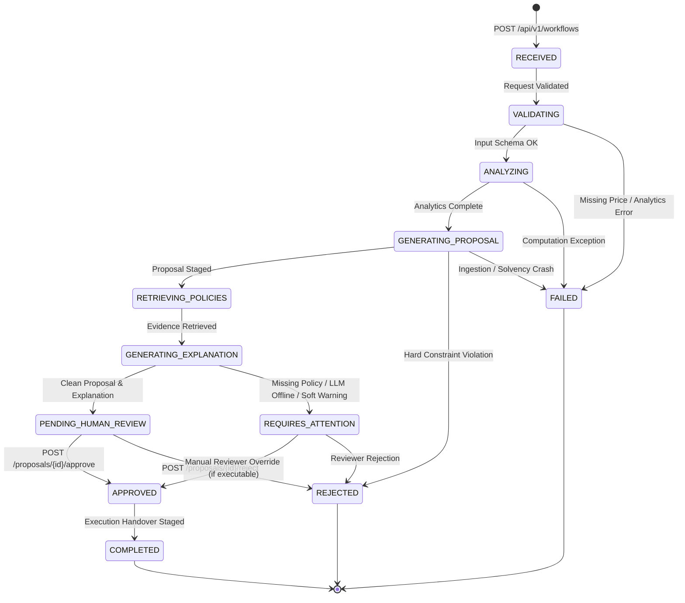
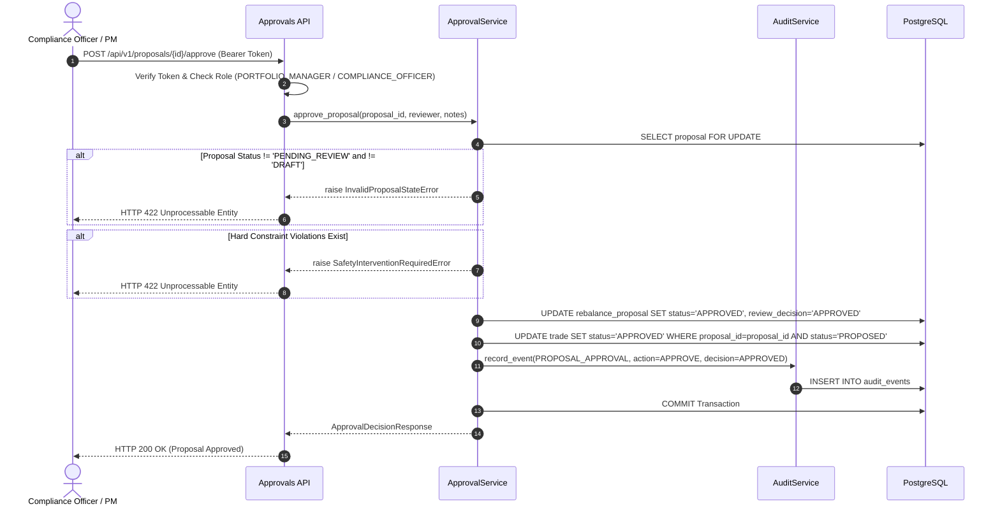

# System Architecture: Policy-Constrained Portfolio Rebalancing System

**Document Version:** 1.0
**Target Repository:** `portfolio-rebalancing-system`
**System Classification:** Financial Analytics & Human-in-the-Loop Rebalancing Recommendation Engine

---

## 1. High-Level Design (HLD)

### 1.1 Architectural Philosophy
The Portfolio Rebalancing Recommendation System is engineered as a **Modular Monolith** designed around strict separation between **deterministic financial computation**, **compliance policy retrieval**, **agentic workflow orchestration**, and **human-in-the-loop governance**.

The fundamental architectural invariant is:
> **The Language Model Explains; It Never Calculates, Approves, or Mutates.**
> All portfolio valuations, drift computations, lot-size rounding, fee tier calculations, and post-trade cash simulations are executed by mathematically pure, deterministic Python and SQL modules. The LLM is strictly sandboxed to summarizing deterministic findings and citing compliance policy evidence.

---

## 2. Low-Level Design (LLD) & Component Responsibilities

### 2.1 Component Breakdown

| Module | Primary Service | Core Responsibilities | Architectural Invariants |
|---|---|---|---|
| `app.services.portfolio_analytics_service` | `PortfolioAnalyticsService` | Portfolio market valuation, position weights, missing price detection, stale price tagging, drift against target allocations, and rebalance trigger evaluations. | Never assumes missing prices are zero; raises `MissingPriceError`. |
| `app.services.rebalancing_service` | `RebalancingService` | Deterministic trade sizing, lot-size rounding, fee tier matching, cash solvency enforcement, post-trade simulation, and `HARD`/`SOFT` constraint evaluation. | Holdings are **never mutated**; live trades are **never executed**. All output is staged as proposals. |
| `app.services.policy_rag` | `PolicyRAGService` | Policy document extraction (PDF/Markdown/Text), hierarchical chunking, local ONNX embeddings (`BAAI/bge-small-en-v1.5`), semantic similarity search, and policy family version resolution. | Treats policy text as **untrusted data**; guards against path traversal and prompt injection. |
| `app.services.explanation` | `ExplanationService` | Builds grounded prompts containing deterministic trade outcomes and retrieved policy chunks; invokes local Ollama; parses JSON output; validates citations against retrieved evidence. | Falls back to deterministic evidence-only summaries if Ollama is offline or returns invalid JSON. |
| `app.services.orchestration` | `WorkflowService` | End-to-end pipeline coordination, lifecycle state machine transitions, canonical request idempotency hashing, and proposal/simulation result persistence. | Proposal generation is called **at most once** per request key; duplicate requests return existing runs. |
| `app.services.approval` | `ApprovalService` | Human review enforcement (`approve_proposal`, `reject_proposal`), status validation, reviewer role verification, and concurrency protection. | Rejected proposals or hard-constraint violations **can never be approved**. |
| `app.services.audit` | `AuditService` | Immutable append-only logging of governance decisions and workflow state changes. | Tables are strictly append-only; zero update or delete endpoints exist. |

---

## 3. Core Data Flow & Sequences

### 3.1 End-to-End Rebalancing Workflow Sequence

---

## 4. Workflow State Machine

The workflow execution lifecycle is governed by an explicit, typed finite state machine defined in [`app/services/orchestration/workflow_state.py`](file:///e:/Yottaflex/portfolio-rebalancing-system/app/services/orchestration/workflow_state.py).

### State Transition Rules
- **Terminal States**: `COMPLETED`, `REJECTED`, and `FAILED` are strictly terminal. No transitions out of these states are permitted.
- **Safety Interventions**: If the rebalancing engine encounters hard constraint violations, the proposal is marked `REJECTED` and the workflow bypasses human approval directly to `REJECTED`.
- **Degraded Execution**: If the policy store yields no evidence or the local Ollama daemon is unreachable, the workflow does **not** fail; instead, it generates a deterministic evidence-only fallback summary, flags `requires_human_review=True`, and enters `REQUIRES_ATTENTION`.

---

## 5. Approval & Audit Governance Lifecycle

Human governance is mandatory. Even after algorithmic proposal generation, no trade can ever be considered approved without an explicit, authenticated decision by a designated reviewer.

---

## 6. Financial & Security Boundaries

### 6.1 Financial Safety Invariants
1. **Holdings Immutability**: The system never issues `UPDATE` or `DELETE` statements against the `holding` table during rebalancing. Holdings represent real-world custodial assets and are modified only via authoritative custodial data loads.
2. **Zero Live Trade Execution**: Trades generated in the `trade` table have status `PROPOSED` or `APPROVED`. The system does not interface with market execution venues or broker APIs.
3. **Hard Constraint Enforcement**: If any trade violates a `HARD` constraint (e.g. `EXCLUDED_INSTRUMENT` or `MAX_POSITION_WEIGHT`), the proposal status is set to `REJECTED`. The approval service explicitly prevents approving any proposal with unresolved hard violations.
4. **Cash Solvency Floor**: Trades are generated such that post-trade cash cannot drop below zero (or below portfolio-mandated cash buffers).
5. **Exact Numeric Arithmetic**: Floating-point types are prohibited for financial calculations; all prices, quantities, and fees use Python `Decimal` and PostgreSQL `NUMERIC(18, 4)`.

### 6.2 LLM Sandboxing & Anti-Hallucination
1. **Deterministic Prompts**: The prompt passed to Ollama contains pre-computed, deterministic trade tables, simulated allocation drift deltas, and retrieved policy chunk excerpts.
2. **System Prompt Isolation**: The system prompt instructs the model to act strictly as a summarizer and compliance reporter, ignoring any instructions embedded inside retrieved policy documents (indirect prompt injection defense).
3. **Citation Grounding Verification**: The `CitationValidator` compares every `[DOC-ID:CHUNK-ID]` citation in the LLM's response against the actual list of chunks retrieved by `PolicyRAGService`. Unsubstantiated citations are stripped or flagged as validation warnings.
4. **Graceful Offline Degradation**: If Ollama times out (5-second default threshold), crashes, or outputs invalid non-JSON text, the system builds an evidence-only summary using deterministic templates and routes the workflow to `REQUIRES_ATTENTION`.

### 6.3 Authentication & Authorization
1. **Fail-Closed Boundary**: Production deployments enforce that all requests to `/api/v1/workflows` and `/api/v1/proposals/*` supply a valid Bearer token. In the absence of an enterprise OAuth2/OIDC provider, all unverified tokens are rejected with `HTTP 401 Unauthorized`.
2. **Explicit Development Mock**: Development and testing environments may set `ENABLE_DEV_MOCK_AUTH=true` to enable fixed reviewer tokens (`dev-reviewer-token`, `dev-admin-token`, `dev-viewer-token`).
3. **Production Safety Guard**: If `APP_ENV=production` and `ENABLE_DEV_MOCK_AUTH=true` are configured simultaneously, the application aborts startup immediately with a fatal security violation.
