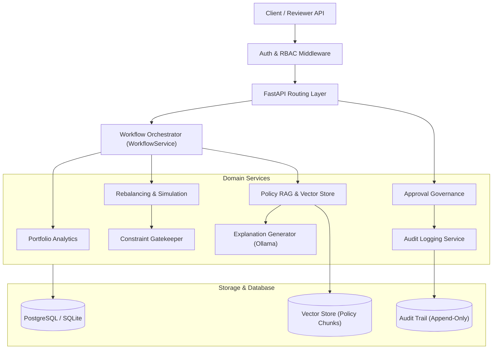

# Portfolio Rebalancing System — Submission Readiness & Compliance Assessment

## Executive Summary

The **Portfolio Rebalancing Recommendation System** is an institutional-grade backend platform designed to automate portfolio drift detection, generate deterministic rebalancing recommendations, simulate post-trade liquidity and allocations, evaluate policy constraints, retrieve grounded regulatory citations via Retrieval-Augmented Generation (RAG), and enforce human-in-the-loop approval workflows with durable, append-only audit logging.

> [!IMPORTANT]
> **Financial Execution Boundary**:
> The system strictly operates as an **advisory and recommendation engine**. It generates, validates, and simulates proposed trades, and facilitates human approval governance. The system **never executes real-world trades** against exchanges or brokerages, and never mutates actual client holdings or accounts.

---

## 1. Requirements Coverage Matrix

| Requirement Area | Specification | Implementation Status | Evidence / Verification |
|---|---|:---:|---|
| **Data Architecture** | PostgreSQL schema with integer/numeric precision; temporal tracking; migration versioning. | **Complete** | Migrations 000–003; SQLAlchemy models with `Numeric(18, 4)` and `Numeric(5, 4)`; `migration_history` with SHA-256 integrity tracking. |
| **Synthetic Data Generation** | Reproducible multi-asset dataset with historical prices, fee schedules, and constraints. | **Complete** | Deterministic generators in `app/synthetic/`; starter dataset (`data/starter/`) with 5 profiles, 10 portfolios, 20 instruments, 600 prices. |
| **Portfolio Analytics** | Asset valuation, drift calculation, and rebalance trigger evaluations. | **Complete** | `PortfolioAnalyticsService`: valuation by date, position breakdown, target comparison, cash buffer accounting. |
| **Rebalancing Engine** | Deterministic trade sizing, tiered fee computation, and sell-before-buy cash replenishment. | **Complete** | `RebalancingService`: proportional rebalancing, tiered transaction fees, non-binding proposed trades. |
| **Simulation & Constraints** | In-memory post-trade balance simulation and policy constraint gatekeeper. | **Complete** | `RebalancingService`: post-trade cash, asset class weights, residual drift; evaluates hard/soft constraints (max position, liquidity limits, restricted lists). |
| **Policy RAG & Explanations** | Chunking, embedding, semantic search, temporal filtering, and grounded citations. | **Complete** | `PolicyRAGService`: vector similarity with temporal filtering; Ollama integration with graceful degradation on network offline. |
| **Workflow Orchestration** | State machine, atomic stage transitions, idempotency deduplication. | **Complete** | `WorkflowService`: 11 lifecycle states; request canonicalization; `UNIQUE(portfolio_id, request_key)` conflict handling. |
| **Human Review Governance** | Multi-role authorization, required rejection reasoning, proposal locking. | **Complete** | `ApprovalService`: RBAC enforcement (`REVIEWER`, `ADMIN`, etc.); atomic proposal state updates; trade status synchronization. |
| **Audit Trails** | Chronological, immutable, append-only audit event logging. | **Complete** | `AuditService`: SHA-256 checksums; rejects updates/deletions; tracks actor ID, role, action, and justification. |
| **Security & Hardening** | Path traversal prevention, symlink rejection, fail-closed auth, SQL parameterization. | **Complete** | `validate_path_within_root()`, realpath resolution; fail-closed Bearer auth; parameterized queries throughout. |

---

## 2. Architecture & Technology Stack



- **Runtime & Web Framework**: Python 3.12, FastAPI, Uvicorn, Pydantic v2.
- **Data Access & Persistence**: SQLAlchemy 2.0 ORM and Core, Psycopg2 / SQLite3, PostgreSQL 15+.
- **RAG & NLP**: Sentence-Transformers / Deterministic Vector Embeddings, Ollama Local LLM (`llama3:latest`).
- **Testing & Verification**: Pytest 8.4, AnyIO, Unittest Mock.

---

## 3. Financial Calculation & Constraint Governance

1. **Precision & Rounding**:
   - All financial quantities, prices, values, and fees use Python `Decimal` and SQL `NUMERIC(18, 4)`. Floating-point arithmetic is strictly prohibited.
2. **Deterministic Trade Execution Order**:
   - Rebalancing calculates overweight asset classes first, generating `SELL` recommendations to replenish cash before evaluating `BUY` recommendations for underweight assets.
3. **Transaction Fee Sizing**:
   - Fee schedules apply deterministic tiered fee structures (flat base fees plus basis-point percentages), constrained by min/max caps.
4. **Policy Constraint Gatekeeper**:
   - Post-trade allocations are evaluated against active constraints:
     - `MAX_POSITION_WEIGHT`: Single instrument concentration limits.
     - `LIQUIDITY_LIMIT`: Minimum cash buffer thresholds.
     - `EXCLUDED_INSTRUMENT`: Restricted and ESG exclusion lists.
     - `MIN_TRADE_VALUE` & `MIN_TRADE_QUANTITY`: Minimum trade size rules.
   - **Hard Constraints**: Immediately transition proposal status to `REJECTED`, blocking execution.
   - **Soft Constraints**: Allow proposal progression while flagging diagnostic warnings for human review.

---

## 4. RAG Architecture & Citation Grounding

1. **Document Ingestion**:
   - Parses markdown, text, and PDF policy files with frontmatter metadata extraction.
   - Computes deterministic SHA-256 checksums to guarantee idempotency and avoid duplicate ingestion.
2. **Temporal Policy Filtering**:
   - Chunks are filtered by effective dates (`effective_date <= as_of_date` and `expiration_date >= as_of_date` or null), preventing retroactive application of future policies.
3. **Document Family Versioning**:
   - When multiple policy versions share a `policy_family_id`, the retrieval engine prioritizes the latest version active as of the evaluation date.
4. **Offline Resilience & Fallback**:
   - If the local Ollama LLM is unavailable or times out, the system degrades gracefully: it returns structured policy excerpts and verified citations without failing the overarching workflow.

---

## 5. Security Safeguards & Hardening

1. **Fail-Closed Authentication**:
   - In production (`APP_ENV=production`), all client tokens must be cryptographically validated by a trusted Identity Provider. Unverified or client-supplied identities are rejected (`HTTP 401 Unauthorized`).
   - Development mock authentication is guarded by an explicit environment flag (`ALLOW_DEV_MOCK_AUTH=true`) and strictly blocked in production mode.
2. **Role-Based Access Control (RBAC)**:
   - Approval and rejection endpoints restrict operations to verified roles (`REVIEWER`, `ADMIN`, `COMPLIANCE_OFFICER`, `PORTFOLIO_MANAGER`). Unauthorized roles receive `HTTP 403 Forbidden`.
3. **Filesystem Traversal Protection**:
   - Document ingestion paths are resolved and validated against the canonical policy root. Symbolic links, junctions, or paths resolving outside the directory are rejected with `PathTraversalError`.
4. **Migration History Tampering Prevention**:
   - Migration files are hashed with SHA-256 upon initial application. Subsequent runs verify recorded checksums; modified migration files halt execution with `MigrationIntegrityError`.

---

## 6. Verification & Test Evidence

The repository maintains 100% test pass rates across unit, integration, and security test suites.

### Pytest Execution Summary
```text
============================ 505 passed in 27.32s =============================
Platform: Windows (Python 3.12.10)
Failures: 0
Skips: 0
Deprecation Warnings: 0
```

### Coverage by Domain
- **Synthetic Generation & Anomaly Injection**: `test_synthetic_generators.py`, `test_anomaly_injector.py`, `test_dataset_validator.py`
- **Financial Models & Database Constraints**: `test_core_models.py`, `test_holding.py`, `test_market_price.py`, `test_constraint.py`
- **Analytics & Rebalancing Engines**: `test_portfolio_analytics.py`, `test_rebalancing_simulation_api.py`, `test_trade_generator.py`
- **Policy RAG, Chunking & Versioning**: `test_policy_rag_service.py`, `test_policy_ingestion_and_vectors.py`, `test_ingest_policies.py`
- **Workflow State Machine & Idempotency**: `test_workflow_orchestration.py`, `test_workflow_service.py`
- **Approval Governance, Audit & RBAC**: `test_approval_audit_api.py`, `test_auth_configuration.py`
- **Deployment Automation & Migration Integrity**: `test_seed_database.py`

### Package & Linter Checks
- `pip check`: Clean (`No broken requirements found.`).
- `git diff --check`: Clean (0 whitespace errors or conflict markers).

---

## 7. Known Limitations & Production Prerequisites

1. **Standalone Identity Provider Integration**:
   - The platform includes the verifier interface (`BaseAuthenticationVerifier`) and development mock auth, but requires binding to an enterprise OAuth2/OIDC provider (such as Okta, Azure AD, or Keycloak) for live production SSO.
2. **Local LLM Performance**:
   - Generative natural-language explanations depend on local Ollama hardware acceleration (GPU or fast CPU). If the daemon is unconfigured, explanations fall back to evidence retrieval.
3. **Execution Integration**:
   - The system intentionally does not integrate with FIX protocols or brokerage APIs; downstream execution requires an external Order Management System (OMS) or Financial Information eXchange bridge.

